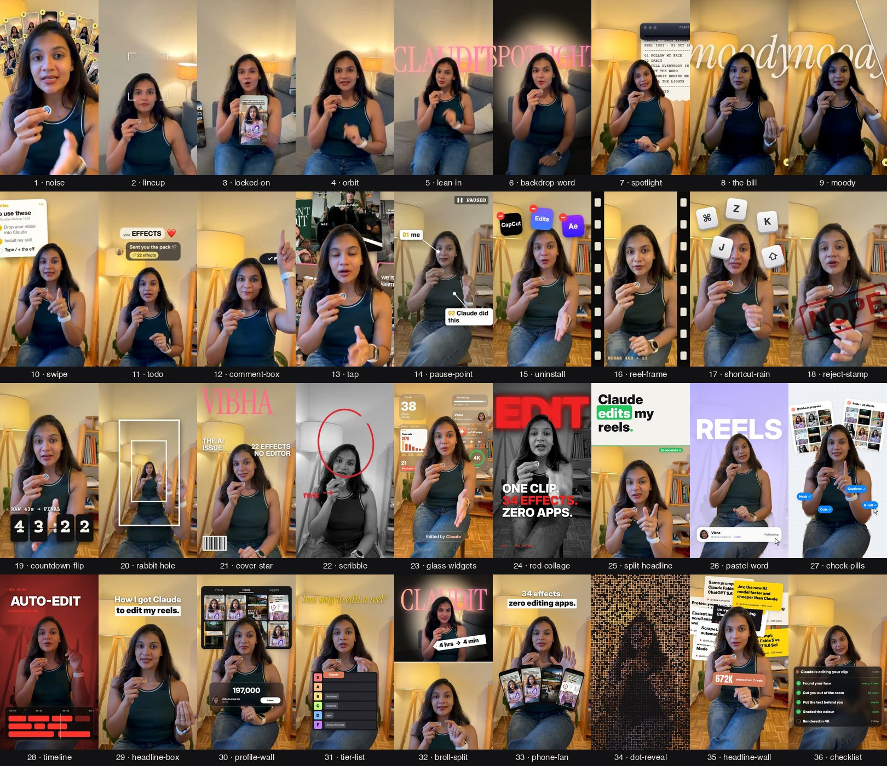

# 42 Video Effects for Cursor

Open this repo in Cursor, drop a talking-head clip into Agent, and type `/effects glass-widgets`. That's the whole edit.

Made by [@vibha.in.progress](https://instagram.com/vibha.in.progress) 💛



## Install in this project

The skill Cursor loads is already in this repo at `.cursor/skills/effects/` (`SKILL.md`, plus `scripts/`, `assets/`, `fonts/`, `models/`, and `requirements.txt`). Paths inside the skill stay relative to that folder.

1. Clone this repo and open the folder in Cursor:

```bash
git clone https://github.com/imanish16/claude-video-effects.git
```

2. Leave the skill where it is. Cursor discovers project skills in `.cursor/skills/` ([Agent Skills](https://cursor.com/docs/skills)).
3. Restart Cursor, or start a new Agent chat, so it picks up `effects`. Confirm it under **Customize → Skills**.

## Use it

1. Open this repo in Cursor and start a new Agent chat.
2. Drag your video into the chat. A vertical talking-head clip works best.
3. Ask for the effect. Typing `/` and choosing `effects` runs the same skill:

```
/effects glass-widgets
/effects glass-widgets for the first 3 seconds
/effects orbit from 3 to 6 seconds
/effects spotlight when I say "kill the lights", with the word Claudit behind me
/effects comment-box at the end, typing CLAUDE
```

Plain language works too: "Add glass widgets to this clip."

The first time, the agent runs `bash scripts/setup.sh` from `.cursor/skills/effects/` (about 1 to 3 minutes). It needs `ffmpeg` and Python 3.10 or newer. If either is missing, setup prints `NEED_FFMPEG` or `NEED_PYTHON` and the agent installs them, then runs setup again.

The agent checks a few frames first, fixes anything that covers your face, then renders `yourvideo_effects.mp4` next to your original. Your audio stays as it was.

You can stack effects in one go: "Add locked-on from 6 to 10s, then orbit from 10 to 13s, then a reject stamp on 'no'."

## Optional: install for every Cursor project

Cursor also loads personal skills from `~/.cursor/skills/` on your machine. Copy the skill folder (the directory that contains `SKILL.md`), not the whole repository:

```bash
git clone https://github.com/imanish16/claude-video-effects.git
mkdir -p ~/.cursor/skills
rm -rf ~/.cursor/skills/effects
cp -R claude-video-effects/.cursor/skills/effects ~/.cursor/skills/effects
```

On Windows (PowerShell):

```powershell
git clone https://github.com/imanish16/claude-video-effects.git
New-Item -ItemType Directory -Force -Path "$env:USERPROFILE\.cursor\skills" | Out-Null
Copy-Item -Recurse -Force .\claude-video-effects\.cursor\skills\effects "$env:USERPROFILE\.cursor\skills\effects"
```

Start a new Agent chat. That copy stays on your machine until you turn on **Settings → Agents → Sync Skills for Cloud Agents**. Only `~/.cursor/skills/` is synced. Cloud Agents that open this repo already get the project skill from `.cursor/skills/effects/` and do not need the global copy.

`~/.agents/skills/` is also read locally. Prefer `~/.cursor/skills/`: that is the directory Cursor documents and syncs.

## Still using Claude Code?

Claude Code reads `~/.claude/skills/effects/SKILL.md`. The skill files in this repo are `.cursor/skills/effects/`. Point the old path at that folder instead of cloning the repository root on top of it:

```bash
git clone https://github.com/imanish16/claude-video-effects.git
mkdir -p ~/.claude/skills
ln -s "$(pwd)/claude-video-effects/.cursor/skills/effects" ~/.claude/skills/effects
```

On Windows, copy the folder to `$HOME\.claude\skills\effects`. Then restart Claude Code.

## The 42 effects

| # | Type this | What happens |
|---|---|---|
| 1 | `noise` | Reels pile up behind your head |
| 2 | `lineup` | Numbered tiles fan out above your head |
| 3 | `locked-on` | Brackets lock onto your face and the camera follows you |
| 4 | `orbit` | Your reels circle your head, behind you at the top |
| 5 | `lean-in` | A quick punch-in on one word |
| 6 | `backdrop-word` | A giant word drops in behind you |
| 7 | `spotlight` | Kill the lights, keep you lit |
| 8 | `the-bill` | Your instructions print out like a receipt |
| 9 | `moody` | A moody colour grade |
| 10 | `swipe` | A before and after slider |
| 11 | `todo` | A checklist beside your head that ticks off as you talk |
| 12 | `comment-box` | An Instagram comment types itself and posts |
| 13 | `tap` | A Follow button flips to Following |
| 14 | `pause-point` | Freeze frame with a hand-drawn arrow |
| 15 | `uninstall` | A glitchy uninstall bar breaks the frame |
| 16 | `reel-frame` | Your video shrinks into a reel card |
| 17 | `shortcut-rain` | Keyboard keys rain down behind you |
| 18 | `reject-stamp` | A big red stamp slams down |
| 19 | `countdown-flip` | A 3, 2, 1 flip clock above your head |
| 20 | `rabbit-hole` | The room tunnels away behind you |
| 21 | `cover-star` | You become a magazine cover |
| 22 | `scribble` | Marker doodles draw themselves around you |
| 23 | `glass-widgets` | Frosted glass widgets and mini artifacts float around your head |
| 24 | `red-collage` | Black and white you, a giant red word behind, three lines slam in |
| 25 | `split-headline` | A headline card slides down and pushes you to the bottom half |
| 26 | `pastel-word` | Lavender room, a giant word behind you, a profile card gets followed |
| 27 | `check-pills` | Grid-paper room, your reels pinned behind you, blue pills get clicked |
| 28 | `timeline` | A dark red film look with an editing timeline and a glowing playhead |
| 29 | `headline-box` | A punch-in with a clean two-line headline |
| 30 | `profile-wall` | Your reels grid fills the wall while a counter ticks up |
| 31 | `tier-list` | A tier list drops in and Claude flies into S tier |
| 32 | `broll-split` | B-roll on top with a price-tag sticker, you below |
| 33 | `phone-fan` | Your reels fan out like a hand of phones |
| 34 | `dot-reveal` | Your shot builds out of glowing dots, then snaps into focus |
| 35 | `headline-wall` | Your headlines pile up behind your head, then a total pops in front |
| 36 | `checklist` | A Claude task list under your chin, each step ticks green |
| 37 | `liquid-glass-graph` | A liquid glass card with a graph that climbs and a number that counts up |
| 38 | `carousel-spin` | Your reels spin around you in a 3D carousel |
| 39 | `match-cut` | News pages cut on one word, locked in place behind your head |
| 40 | `apple-toggles` | iPhone switches flip on under your chin, one line at a time |
| 41 | `led-sign` | The lights drop and a glowing LED sign types itself out behind you |
| 42 | `slow-push` | A slow cinematic push-in while the room melts out of focus |

Bonus looks: `/effects glitter-spotlight` (golden rays and sparkles), `cover-star look=editorial` (a classic magazine cover) and `liquid-glass-graph look=bento` (a glass dashboard around you).

Every effect follows your face. Anything that would cover your face goes behind your head instead.

**Tips**
- Vertical phone videos with you in frame work best.
- Say the timing in plain words ("when I say 'watch'"). The agent finds the exact second.
- Want your own reels in `orbit`, `noise`, `phone-fan` or `profile-wall`? Give the agent a folder of screenshots.
- Charts, counters and headlines should use your real numbers. Tell the agent what they are.
- It renders in 1080p. Ask for 4K if you want it (slower).

## Honest notes
- These are **starter versions**. They won't match the exact edit in the original reel, which also has sound design and hand-tuned timing.
- It drafts, you approve. Watch the result before you post.
- No sounds or captions are added. Add those in CapCut.
- The full edit style is coming later. Follow [@vibha.in.progress](https://instagram.com/vibha.in.progress) to hear first.

## If something goes wrong
Tell the agent what you see ("the word covers my face", "it's too fast"). It will fix the plan and render again.

## Credits
Face tracking: [OpenCV YuNet](https://github.com/opencv/opencv_zoo) (MIT). Person cut-out: [MediaPipe Selfie Segmenter](https://ai.google.dev/edge/mediapipe/solutions/vision/image_segmenter) (Apache 2.0). Fonts: Archivo Black, Instrument Serif, Space Mono, Inter, Anton, Montserrat (SIL OFL) and Permanent Marker (Apache 2.0); licences are in `.cursor/skills/effects/fonts/`. Everything else: MIT, see `LICENSE`.
